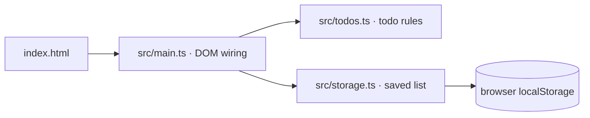

# Architecture

The macro technical shape: the stack, how the pieces fit, and the decisions behind them. Point to the code, do not restate it.

## Stack

- TypeScript in the browser, no UI framework: `src/main.ts` builds the DOM by hand and wires it to the todo rules.
- Vite+ (`vp`) for dev server, build, format, lint, types and tests; pnpm; the shared OKQ base config from `quality-gate`.

## How it fits together

## Key decisions

- No UI framework: the training is about the method, and plain DOM code reads without framework knowledge.
- `vite.config.ts` spreads the OKQ `qualityGate` base config and only adds this app's test paths. Rules are never loosened here.
- The todo rules and the storage adapter never touch the DOM; the storage is passed in, so both are unit tested without a browser.
- Saved data is untrusted: anything that is not a list of well-formed todos loads as an empty list, and every storage access is guarded because a disabled storage throws even on read.
- Todos are identified by a generated id, never by title or position: duplicate titles are allowed.

## Gotchas

- Import from `vite-plus` and `vite-plus/test`, never from `vite` or `vitest`: the base lint config enforces it.
