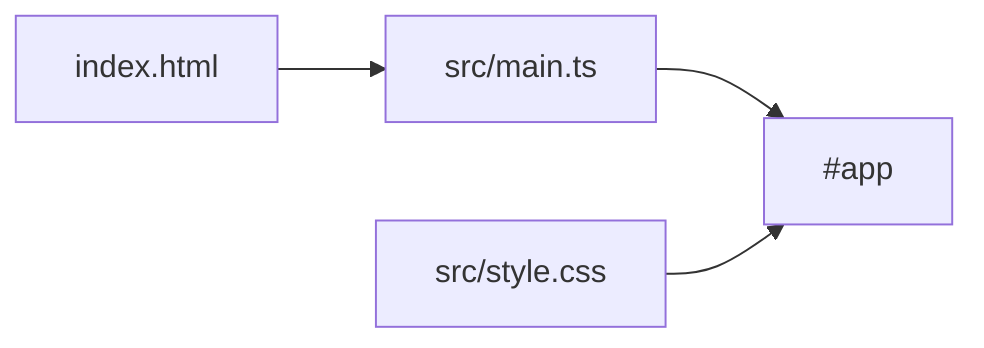

# Architecture

The macro technical shape: the stack, how the pieces fit, and the decisions behind them. Point to the code, do not restate it.

## Stack

- TypeScript in the browser, no UI framework: the DOM is rendered by hand from `src/main.ts`.
- Vite+ (`vp`) for dev server, build, format, lint, types and tests; pnpm; the shared OKQ base config from `quality-gate`.

## How it fits together

## Key decisions

- No UI framework: the training is about the method, and plain DOM code reads without framework knowledge.
- `vite.config.ts` spreads the OKQ `qualityGate` base config and only adds this app's test paths. Rules are never loosened here.
- `passWithNoTests` is set only while the app has no logic to test.

## Gotchas

- Import from `vite-plus` and `vite-plus/test`, never from `vite` or `vitest`: the base lint config enforces it.
