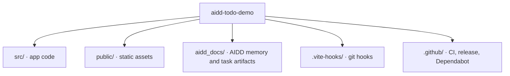

# Codebase Map

The macro layout: the top-level areas and what each holds. A map to navigate, not the full tree.

## Areas

- `src/`: the app, its styles, and its tests next to the code (`*.test.ts`).
- `aidd_docs/`: the AIDD memory bank and, per step, the task artifacts. Committed on purpose: they are training material.
- `.changeset/`: pending changesets for user-facing changes.

## Entry points

- `index.html` loads `src/main.ts`, which renders into `#app`.
